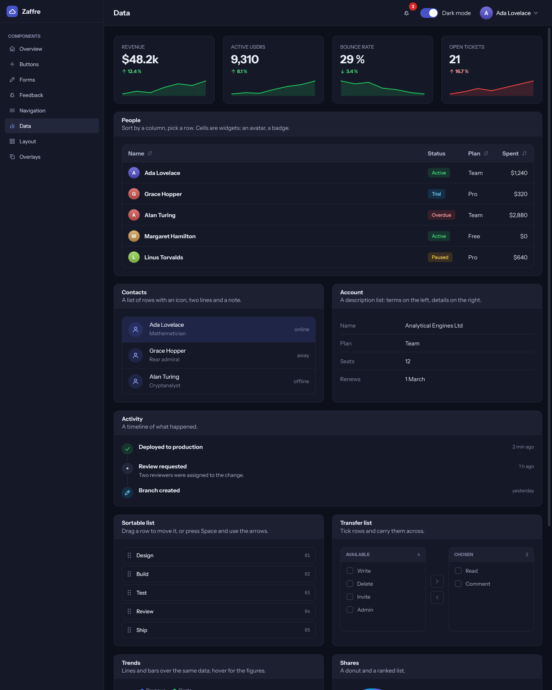
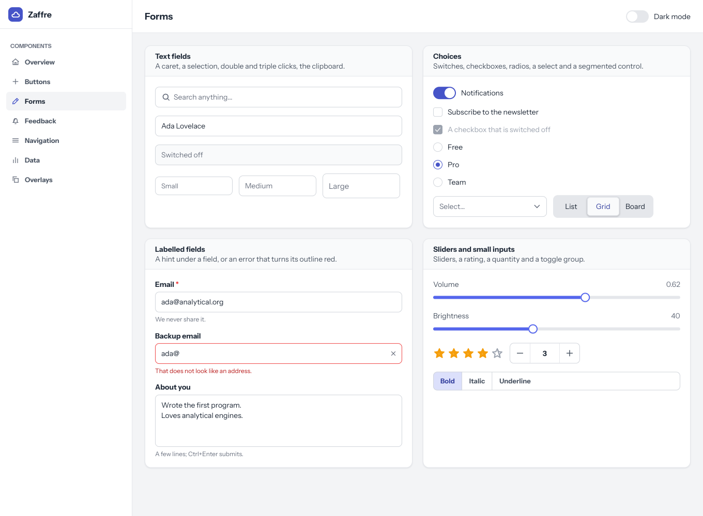
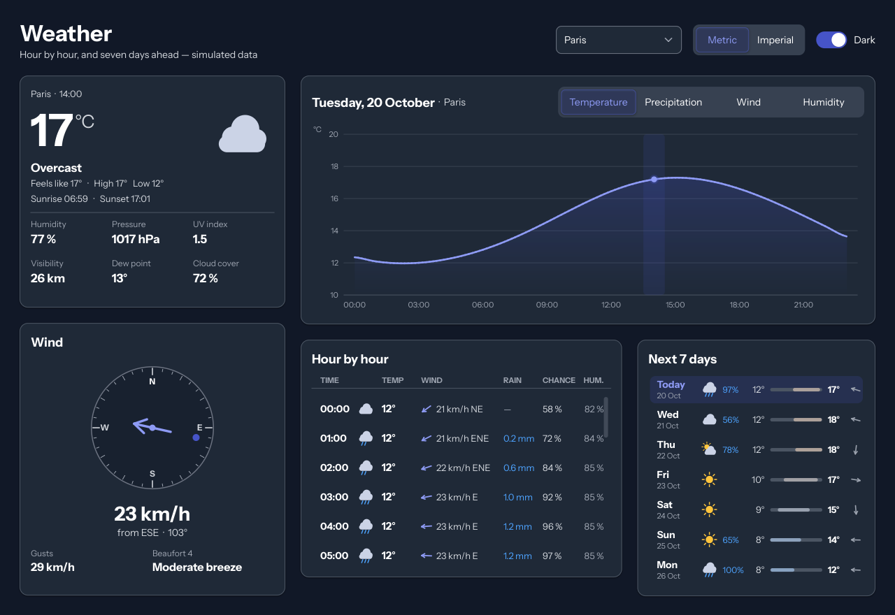
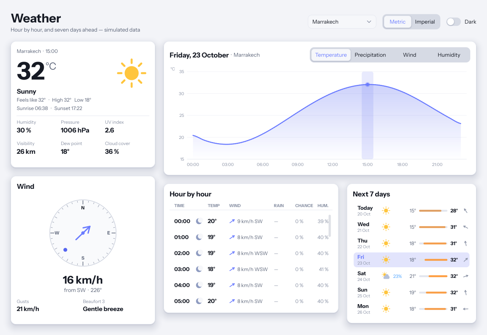

<div align="center">

# 🔷 Zaffre

### A native UI library for [**Axle**](https://axle-lang.dev) — soft, typographic, themeable, and nothing but [smalt](https://github.com/Axle-lang/smalt)

<p align="center">
  <a href="https://axle-lang.dev"></a>
  <a href="https://github.com/Axle-lang/smalt"></a>
</p>
<p align="center">
  
  
  
  
</p>

 
 

<sub>The gallery's data page in the dark theme and its forms page in the light one, then the weather example in both — all written by the programs themselves: <code>--snap</code> draws one frame and puts it in a file.</sub>

<br>

<sub><a href="#examples">Examples</a> · <a href="#building">Building</a> · <a href="#verification">Verification</a> · <a href="doc/VISION.md">Vision</a> · <a href="doc/ARCHITECTURE.md">Architecture</a> · <a href="doc/COMPONENTS.md">Components</a> · <a href="LIMITATIONS.md">Limitations</a> · <a href="https://github.com/Axle-lang/smalt">smalt ↗</a> · <a href="https://axle-lang.dev">Axle ↗</a></sub>

</div>

---

> **Status.** The library and its two examples build and run with the development build of Axle
> (0.18.1-dev), on Windows; the released 0.18 stops on cross-crate types (`E0014`). `axle check` is the
> last word, and `tools/` holds what runs beside it (see [Verification](#verification)).
> `LIMITATIONS.md` says what is built, what is unverified and what is missing.

Zaffre draws the interface you would expect from a good web app — rounded surfaces, soft shadows,
real typography, motion — through smalt's CPU frame, with no library outside smalt. The look is
yours: every colour, radius, shadow and duration is a token, every widget is made of named parts,
and a theme is a value.

```rs
use zaffre::{
    View, Theme, Fonts, App, AppDesc, Notifier, Notifications, Model, Widget, Button, ButtonProps,
    ButtonKind, Switch, Panel, PanelProps, Elevation, Column, Row, FlexProps, Label, TextRole, Slider,
    SliderProps, Tone,
    // Named by the defaults of the structs above, so the program names them too.
    Insets, Length, ControlSize, IconKind, Align, Justify,
};

fn main() : i32 {
    let fonts : Shared<Fonts> = new shared Fonts();
    let dark = new shared Model<bool>(true);
    let volume = new shared Model<f64>(0.62);
    let notes = new shared Notifier();

    let save = new Button(
        ButtonProps { label: "Save", kind: ButtonKind::Primary },
        () => notes.toast("Saved", Tone::Ok)
    );
    let actions : dyn Widget[] = [save, new Switch("Dark mode", dark)];
    let kids : dyn Widget[] = [
        new Label("Preferences", TextRole::H3),
        new Slider(SliderProps { label: "Volume" }, volume),
        new Row(FlexProps { gap: 10.0 }, actions),
    ];
    let column = new Column(FlexProps { gap: 14.0 }, kids);
    let card = new Panel(PanelProps { elevation: Elevation::Raised }, column);

    let view = new View(Theme::dark(), fonts, dark, new Notifications(notes, card));
    return App::run(AppDesc { title: "demo", width: 640, height: 400 }, view);
}
```

A widget tree is built from `new`, children going in a `dyn Widget[]` a parent takes; the values
widgets show are `Model`s the program holds, so nothing is synchronised by hand; handlers are lambdas
over `Shared` handles. Layout is
constraints going down and sizes coming up (`Flex`, `Panel`, `Scroll`, …); drawing goes through a
`Painter` that a CPU backend implements today and a GPU backend could implement tomorrow.

* **[Vision](doc/VISION.md)** — what it is for and the principles
* **[Architecture](doc/ARCHITECTURE.md)** — layers, one frame, memory, styles, widgets
* **[Components](doc/COMPONENTS.md)** — what exists and how far it is verified
* **[Limitations](LIMITATIONS.md)** — what is not here, and what is not proven

## Examples

| | |
|---|---|
| `examples/gallery` | every component, in an application of its own: a sidebar, a top bar, one page per section; `--snap` writes `gallery.bmp` with no window |
| `examples/weather` | a forecast app: the day hour by hour, the wind, the week ahead (generated data — smalt has no network) |

## Building

```bash
git clone --recursive https://github.com/Axle-lang/zaffre
cd zaffre
cd examples/gallery
axle run                     # or: axle build; add -- --snap for a picture with no window
```

`vendor/smalt` is a submodule pinned to smalt's `dev` branch, which carries what the shell uses and
`main` does not yet: `Window::setCursor`, the system clipboard, click counts and `MouseLeft`.

## Verification

`axle check` (or `axle build`) is the compiler's word. Beside it:

| Tool | What it holds |
|---|---|
| `tools/check.py` | imports resolve, layers never reach upward, no `extern`/`unsafe`, reserved words, names, mutability, member and arity checks (`axparse.py` + `axcheck.py`, calibrated on smalt's own sources) |
| `tools/c_ref/` | C twins of the rasteriser and the kerning reader, checked against FreeType and HarfBuzz |
| `tools/axpy/` | an Axle → Python translator that runs the real sources (`test_text.py`, `test_ui.py`, `test_weather.py`, `shot.py` for the pictures above); it checks logic, not syntax, and has fallen behind smalt's newer names |
| `tools/gen_lib.py --check` | `src/lib.axle` names every module |

The gallery is also the integration test: `--snap` draws a frame with no window, and a program can
feed `View::input` its own events to click, type and scroll in it.

## License

MIT. The bundled fonts (`assets/fonts/`) are under the SIL Open Font License; their licences sit
beside them.
